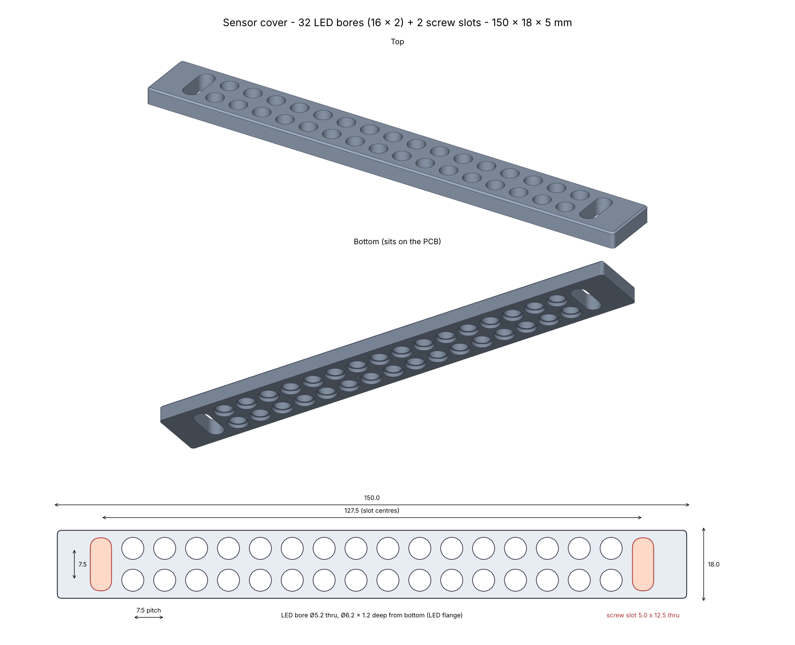

# Sensor cover

Cover for the LED strip in the "LED Strip Assembly and Gap Plan" blueprint.



## Files

- `sensor_cover.step` – 3D model for CAD
- `sensor_cover.stl` – 3D model for printing
- `sensor_cover.py` – the model's source (CadQuery); change a value and run it to make new STEP and STL files
- `sensor_cover_preview.png` – views and main dimensions

## Dimensions (mm)

| | |
|---|---|
| Cover | 150.0 × 18.0 × 5.0 |
| LED bores | 32 (16 × 2), Ø5.2 through |
| LED flange pocket | Ø6.2 × 1.2 deep, from the bottom |
| LED pitch | 7.5 along the strip, 7.5 row to row (2.5 gap) |
| Screw slots | 2, at the outer position pair of each end, 5.0 wide × 12.5 long, through |
| Slot centres | 127.5 apart |

The bottom face sits on the PCB. The outer position pair at each end of the strip is a screw slot, not LEDs.

## Rebuild

```bash
pip install cadquery
```

```bash
python sensor_cover.py
```
