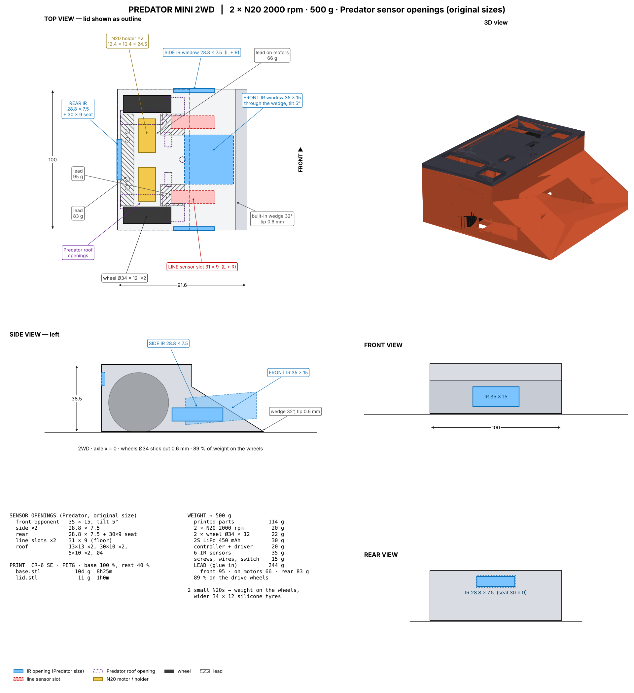
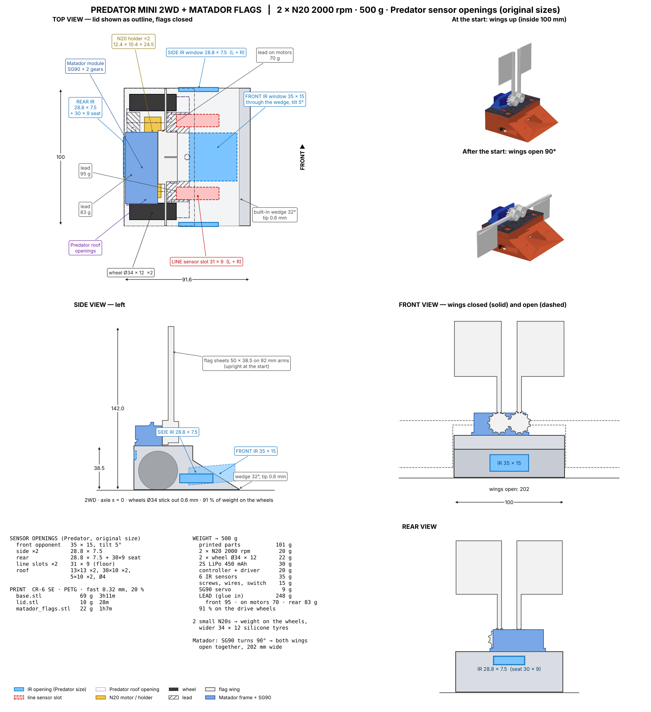
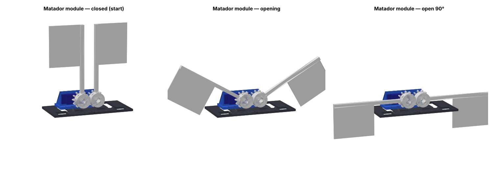

# Predator Mini 2WD + Matador flags

* **Size 91.6 × 100 mm** (fits 10 × 10 cm), 38.5 mm tall. 2 × N20 2000 rpm.
* **Kept from Predator:** built-in 32° wedge with the front IR window through the slope, every sensor opening at its original size.
* **Small N20s compensated:** CG just ahead of the axle → 91 % of the 500 g on the drive wheels; wedge tip skims at 0.6 mm;
  wider Ø34 × 12 silicone wheels (make them with `wheel-mold`, set the size to 34 × 12); lead low in the body.
* **Flags (Matador style):** SG90 lying behind a wall, two 12-tooth gears (module 1.5) make the wings turn in opposite directions.
  Flag sheets 50 × 38.5 mm on 92 mm arms: upright inside the footprint at the start (142 mm tall); the servo turns
  90°, the arms go out flat to the sides and the sheets hang beside the robot (202 mm wide, bottom 10 mm off the floor).
  Bolt the module to the lid with 2 × M3; same lid for both robots.

| file | g | time |
|---|---|---|
| `base.stl` | 69 | 3h11m |
| `lid.stl` | 10 | 28m |
| `matador_flags.stl` | 22 | 1h7m |

| | regular | with flags |
|---|---|---|
| printed | 79 g | 101 g |
| lead: front / on motors / behind motors | 95 / 101 / 83 g | 95 / 70 / 83 g |
| on the drive wheels | 91 % | 91 % |

**Matador assembly:** press gear 1 onto the SG90 spline + horn screw; gear 2 on an M3 × 16 into the pillar; servo into the wall
(2 tab screws); slide each wing into its gear slot and pin it (M2 screw or 2 mm filament). Set the servo so both wings point up,
then in code: at the start signal turn the servo 90°. Check your event's flag rules (some allow max 2–4 flags, upright and
inside the robot's outline at the start).
