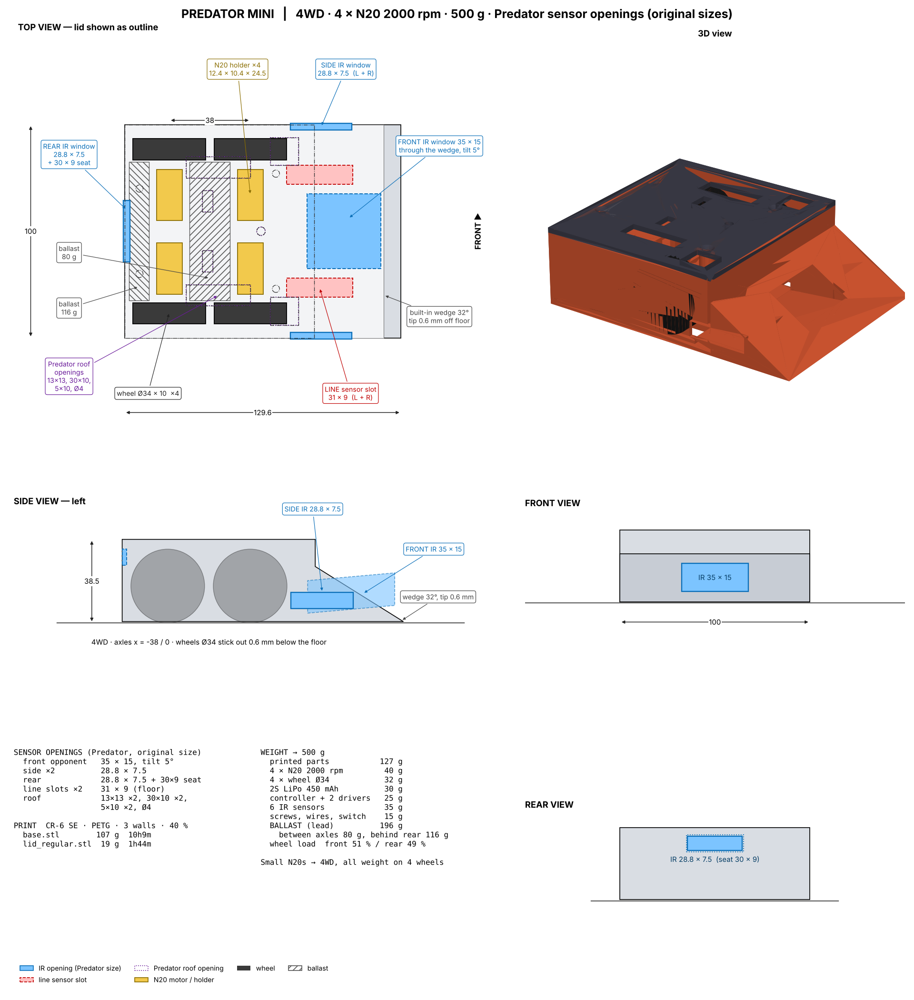
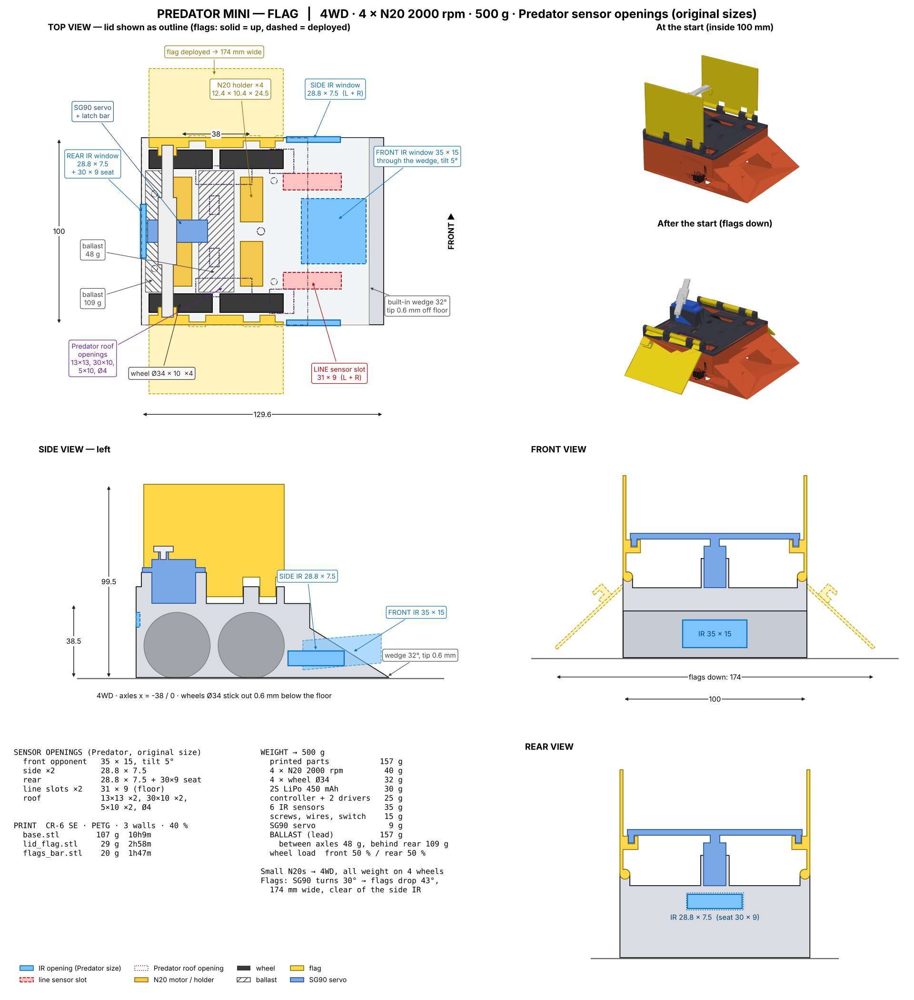

# Predator Mini — your Predator as a 500 g N20 mini sumo

* **Kept from Predator:** built-in 32° front wedge with the front IR window coming out through the slope, and all sensor openings
  at their original size: front 35 × 15 (tilt 5°), side 28.8 × 7.5 (L + R), rear 28.8 × 7.5 + 30 × 9 seat,
  floor line slots 31 × 9 (L + R), roof 13 × 13 (×2), 30 × 10 (×2), 5 × 10 (×2), Ø4.
* **Small N20s compensated:** 4 × N20 2000 rpm (4WD; holders 12.4 × 10.4 × 24.5 mm, Ø4.4 boss, 2 × M1.6 at 9 mm),
  wheels Ø34 × 10 (cast them with `wheel-mold`, 34 × 10) stick out 0.6 mm below the floor, so all weight is on the wheels and the wedge tip skims at 0.6 mm.
* Size 129.6 × 100 mm, 38.5 mm tall (flag version 99.5 mm at the start). Base prints flat on the bed, no supports.
* Side and line sensors sit in pockets inside the wedge, reached from the inside.

| file | g | time |
|---|---|---|
| `base.stl` | 107 | 10h9m |
| `lid_regular.stl` | 19 | 1h44m |
| `lid_flag.stl` | 29 | 2h58m |
| `flags_bar.stl` | 20 | 1h47m |

| | regular | flag |
|---|---|---|
| printed | 127 g | 157 g |
| lead ballast: between axles / behind rear motors | 80 / 116 g | 48 / 109 g |
| front / rear wheel load | 51 / 49 % | 50 / 50 % |

Flag version: SG90 turns the latch bar 30° at the start → flags drop to 43° below horizontal, 174 mm wide;
they end before the side IR windows so they don't block them. Hinge pin: 1.75 mm filament.
