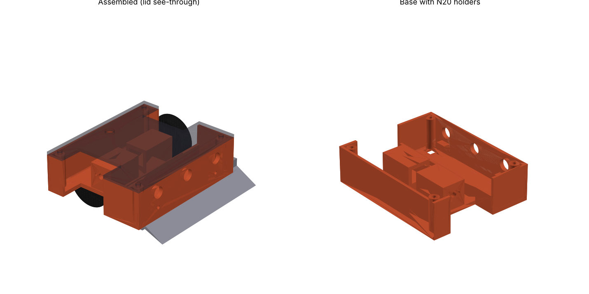

# Mini sumo — 99 × 99 mm, 500 g

Revised from Predator (base + top + front): same layout, shrunk to the 10 × 10 cm class.

| print (CR-6 SE, PETG, 3 walls, 40 % infill, no supports) | g |
|---|---|
| `base.stl` — floor down | 59 |
| `lid.stl` — flat | 16 |
| `blade.stl` — flange down | 6 |

* **N20 holders** (in the base): tunnel 12.4 × 10.4 mm, 24.5 mm long (N20 2000 rpm with gearbox), Ø4.4 boss hole,
  2 × M1.6 screw holes 9 mm apart on the gearbox face. Slide the motors in from the middle.
* **Wheels** Ø34 × 10 mm on the 3 mm D-shaft, axle 18 mm behind centre, inside the 99 mm width.
* **Blade**: 30° sharp wedge, full width, 2 × M3 into the base front.
* **Lid**: 4 × M3 into the posts, Ø6.5 power switch hole. 3 opponent-sensor windows Ø8.5 in the front, 2 line-sensor holes in the floor.

## Weight to 500 g
| item | estimate |
|---|---|
| printed parts | 81 g |
| 2 x N20 motor | 20 g |
| 2 x wheel Ø34 | 16 g |
| 2S LiPo ~450 mAh | 30 g |
| controller + driver | 20 g |
| 3 opponent + 2 line sensors | 20 g |
| screws, wires, switch | 15 g |
| **ballast to add** | **≈ 298 g** — lead in the bay behind the blade (26 × 92 × 14 mm ≈ 33 cm³ holds ≈ 370 g lead; steel only ≈ 260 g, put the rest under the lid) |

N20 at 2000 rpm with Ø34 wheels: ≈ 3.6 m/s top speed.
