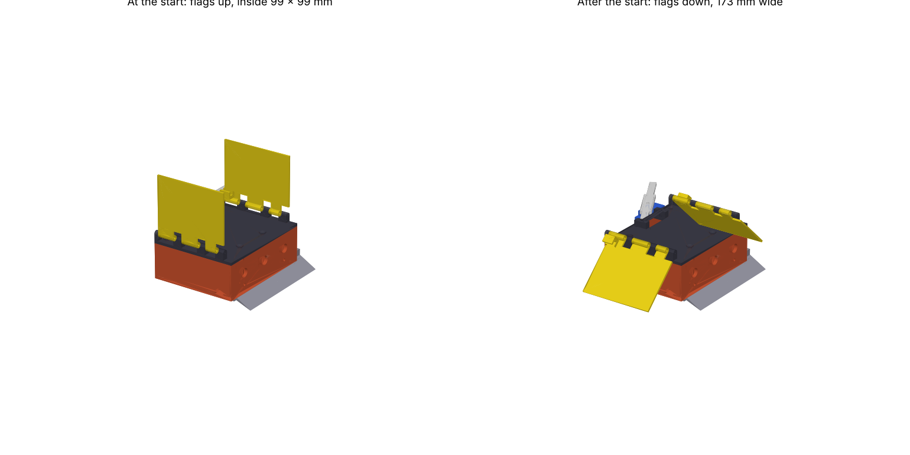

# Flag mini sumo — 99 × 99 mm body, 500 g

| print (CR-6 SE, PETG, 3 walls, 40 % infill, no supports) | g | time |
|---|---|---|
| `base.stl` — floor down | 69 | 6h26m |
| `lid.stl` — flat, hinge knuckles up | 24 | 2h22m |
| `blade.stl` — flange down | 6 | 34m |
| `flags_bar.stl` — 2 flags flat + latch bar | 19 | 1h42m |

## Flags
* At the start both flags stand up on the lid edges, inside the 99 × 99 mm footprint (robot 100 mm tall).
* SG90 servo at the rear turns the latch bar ~30° → its pins leave the flag teeth → the flags fall outward,
  rest at 43° below horizontal on the lid edge: 173 mm wide, tips 5 mm off the floor,
  covering the height the opponent's sensors look at.
* Hinges: 1.75 mm filament as the pin (push it in from the back corner; snug in the lid, free in the flags).
* Re-arm: lift the flags, servo back to 0°. Release in code right when the start delay ends.
* Servo horn: the stock SG90 double horn sits in the groove under the bar; horn screw + a drop of glue.

## Body
* Sensor openings exactly as before: 3 × Ø8.5 front windows (z 22, y −30/0/30), 2 × 8 × 8 mm floor holes.
* N20 holders unchanged (12.4 × 10.4 × 24.5 mm tunnel, Ø4.4 boss, 2 × M1.6 at 9 mm), axle moved to x = -8
  so the weight sits on the wheels; wheels Ø34 × 10 now fully inside the side armour.
* Blade: 30° sharp wedge, 2 × M3. Lid: 4 × M3 countersunk, Ø6.5 switch hole.

## Weight to 500 g
| item | g |
|---|---|
| printed parts | 119 |
| 2 x N20 2000 rpm | 20 g |
| 2 x wheel Ø34 | 16 g |
| SG90 servo | 9 g |
| 2S LiPo ~450 mAh | 30 g |
| controller + driver | 20 g |
| 3 opponent + 2 line sensors | 20 g |
| screws, wires, switch | 15 g |
| **ballast to add** | **≈ 251** |

Ballast goes flat on the floor in front of the motors (bay ≈ 23 cm³ at 11 mm high → ≈ 258 g of lead;
steel ≈ 179 g, rest on top of the motor holders). Glue it down.
Balance: CG 9 mm ahead of the axle, 17 mm high → ≈ 84 % of the weight on the wheels.
