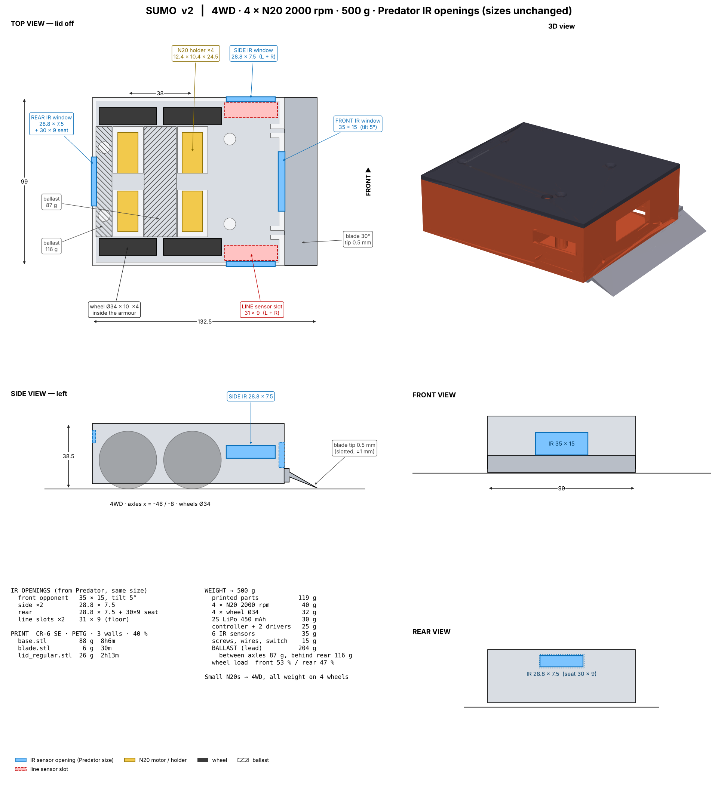
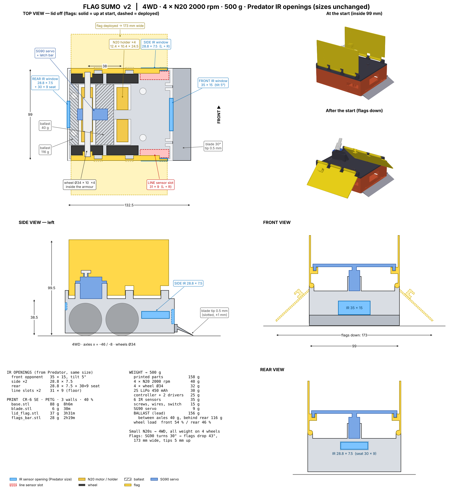

# Sumo v2 — regular + flag, one 4WD body

* **IR openings = your Predator files, same sizes:** front opponent window 35 × 15 (tilted up 5°),
  side windows 28.8 × 7.5 (L + R), rear window 28.8 × 7.5 with a 30 × 9 seat, floor line slots 31 × 9 (L + R).
* **Small N20s compensated:** 4 × N20 2000 rpm (4WD; holders 12.4 × 10.4 × 24.5 mm, Ø4.4 boss, 2 × M1.6 at 9 mm),
  all weight on 4 wheels Ø34, blade tip skims at 0.5 mm (slotted screw holes, ±1 mm).
* Body 132.5 × 99 mm, 38.5 mm tall (flag version 99.5 mm at the start). Same base + blade for both; only the lid changes.

| file | g | time |
|---|---|---|
| `base.stl` | 88 | 8h6m |
| `blade.stl` | 6 | 30m |
| `lid_regular.stl` | 26 | 2h13m |
| `lid_flag.stl` | 37 | 3h31m |
| `flags_bar.stl` | 28 | 2h19m |

| | regular | flag |
|---|---|---|
| printed | 119 g | 158 g |
| lead ballast: between axles / behind rear motors | 87 / 116 g | 40 / 116 g |
| front / rear wheel load | 53 / 47 % | 54 / 46 % |

Battery flat on top of the motor holders. Flags: SG90 turns the latch bar 30° at the start → flags drop to 43° below horizontal,
173 mm wide, tips 5 mm off the floor. Hinge pin: 1.75 mm filament.
