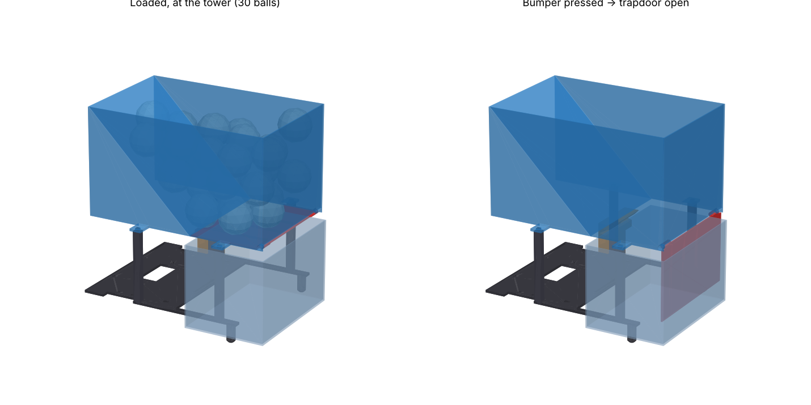

# Trapdoor ball robot — dispenses on contact

CR-6 SE, PETG, 0.2 mm, **supports off** (G-code ready, profile `cr6se_petg.ini`).

| file | print as | PETG | time | G-code |
|---|---|---|---|---|
| `hopper_door.stl` | as is: open top up, door on the bed (hinge prints in place) | 136 g | 11h 47m 21s | `hopper_door_PETG_11h47m.gcode` |
| `chassis.stl` | as is: upside down, skids up | 49 g | 4h 2m 35s | `chassis_PETG_4h3m.gcode` |
| `bumper_posts.stl` | as is: bumper on its side + 4 posts lying | 38 g | 3h 51m 54s | `bumper_posts_PETG_3h52m.gcode` |

## How it works
1. Robot drives at the tower's 150 mm face. Arms + skids pass beside the tower (5 mm each side); hopper floor is 10 mm above the tower top.
2. Bumper nub hits the tower → PETG plate bends back → its tongue slides out from under the door's rear edge after 3.3 mm → trapdoor swings down, balls drop straight into the tower. 45° back slope feeds the last ones.
3. Chassis front edge is the hard stop, 8 mm after first contact.
4. Backing away: the tower wall pushes the hanging door forward; it flips out under the front wall (no jam).
5. Reset: push the door up — the 45° cam on the tongue clicks it shut.

## After printing / assembly
* Snap off the thin fin under the hopper's front wall (support for that wall). Work the door a few times.
* 4 posts: square tenons into the chassis and hopper bracket holes (drop of CA glue).
* Bumper: rib into the chassis front slot (glue).
* Your N20 brackets: 2 × M3 each (19.5 mm holes, axle at x = 0). MCB on the xsx hole pattern. Sensor bar on the front slots.
* Battery centre ~30 mm in front of the axle.

## Numbers
| | |
|---|---|
| capacity | 31 balls of 40 mm fit below the rim (hopper 130 mm tall, top at 240 mm) |
| trapdoor | 87 × 139 mm, hinge Ø6 knuckles, 45° cone pins, 0.4 mm gaps |
| release | nub travel 3.3 mm, push ≈ 1.1 N (spring 0.29 N/mm + friction), plate strain 0.40 % at 8 mm (PETG yield ≈ 3 %) |
| mass | ≈ 493 g loaded (assumed: N20 ×2, wheels, MCB 30 g, battery 95 g, sensor bar 20 g) |
| CG | x = 55 mm, z = 93 mm → 62 % of weight on the drive wheels |
| tipping | sideways 0.90 g, forward (braking) 0.97 g, backward 0.59 g |
