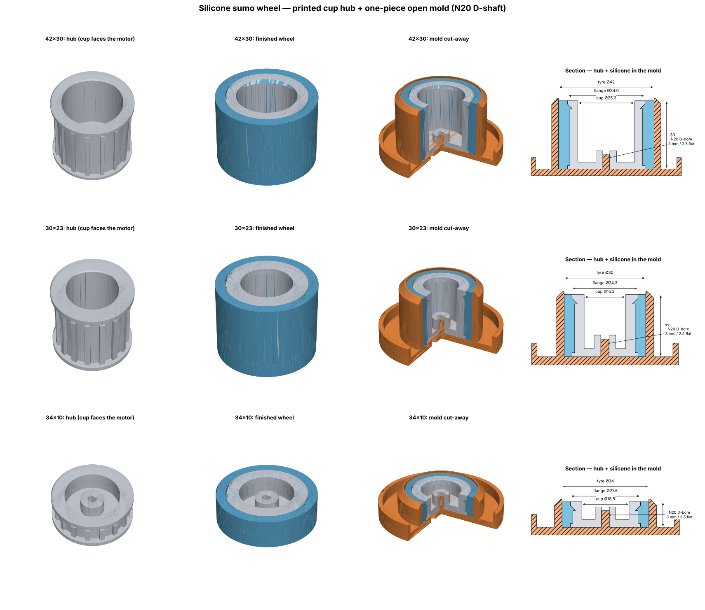

# Silicone sumo wheel — hub + one-piece mold

Like the MakerPH photo: printed cup hub (flange ring flush with the tyre face, deep cup), silicone tyre cast on it.
One-piece open mold like your `mold_onepiece_62.4mm`: cup = tyre OD, centre D-key holds the hub, spill tray, 2 push-out holes.

| wheel Ø × width | 4 hubs (PETG, 100 % infill) | mold (PETG) | silicone per wheel |
|---|---|---|---|
| 42 × 30 | `hub_42x30_x4` 61 g, 5h43m | `mold_42x30` 27 g, 2h11m | 18.9 cm³ |
| 30 × 23 | `hub_30x23_x4` 35 g, 3h27m | `mold_30x23` 17 g, 1h24m | 7.8 cm³ |
| 34 × 10 | `hub_34x10_x4` 21 g, 1h54m | `mold_34x10` 13 g, 1h5m | 4.0 cm³ |

**Hub:** N20 3 mm D-shaft bore (press fit + drop of CA), the gearbox sits inside the cup. 16 ribs + 2 flanges lock the tyre.

**Casting**
1. Thin mold release on the mold cup and floor (not on the hub).
2. Push the hub onto the centre key, cup facing up. Put a coin/nut in the cup so it can't float.
3. Mix silicone (Shore 20–30 A, platinum or tin cure), degas if you can, pour slowly into the ring gap
   up to the hub's top face. Spill goes into the tray.
4. Cure, then push the wheel out through the 2 holes under the hub. Trim the top edge if needed.
